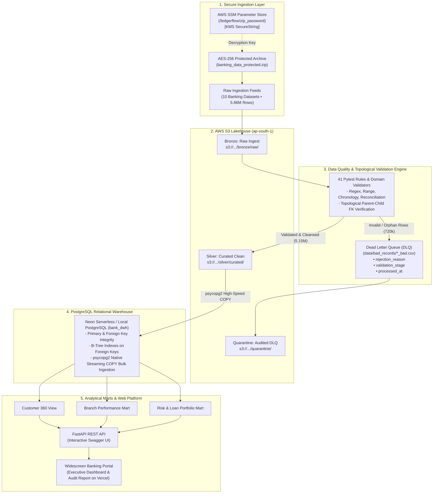

# LedgerFlow — Banking Data Engineering Pipeline & Analytical Warehouse

[](https://github.com/Spidey173/LedgerFlow/actions/workflows/ci.yml)
[](https://ledgerflow17.vercel.app/)
[](https://ledgerflow17.vercel.app/audit-report)
[](https://ledgerflow17.vercel.app/docs)
[](https://neon.tech)
[](https://aws.amazon.com/s3/)
[](cloud_aws/secure_ingest.py)
[](tests/test_validation.py)
[](docker-compose.yml)

> 🏦 **Live Banking Executive Dashboard**: **[https://ledgerflow17.vercel.app/](https://ledgerflow17.vercel.app/)**  
> 📑 **Data Quality & DLQ Audit Report**: **[https://ledgerflow17.vercel.app/audit-report](https://ledgerflow17.vercel.app/audit-report)**  
> ⚡ **Interactive Swagger REST API**: **[https://ledgerflow17.vercel.app/docs](https://ledgerflow17.vercel.app/docs)**  
> ☁️ **AWS S3 Cloud Lakehouse**: `s3://ledgerflow-banking-511492912610/` (Bronze `raw/`, Silver `curated/`, DLQ `quarantine/`)  
> 🔐 **AWS Systems Manager (SSM)**: Decrypts AES-256 banking archives dynamically via KMS `SecureString` (`/ledgerflow/zip_password`)  
> 📊 **Analytical Warehouse**: Neon Serverless PostgreSQL running ~5.15M curated records across 10 relational entities

---

## 📌 Executive Summary

**LedgerFlow** is a production-grade banking data engineering pipeline and relational data warehouse built using **Python, PostgreSQL, AWS S3, and AWS Systems Manager (SSM)**. 

Processing **5.86 million core banking records** across 10 interconnected entities, the project solves the core engineering challenges encountered in modern financial institutions:
1. **Topological Dependency Ordering**: Enforces strict parent-child validation hierarchy to prevent foreign key constraint violations prior to database bulk loading.
2. **Automated Dead Letter Queue (DLQ)**: Quarantines invalid records (720k+ rows) with audit metadata (`rejection_reason`, `validation_stage`, `processed_at`) rather than silently dropping or crashing.
3. **Enterprise Ingestion Security**: Protects raw data feeds using AES-256 encrypted ZIP archives decrypted on the fly using credentials stored in **AWS SSM Parameter Store** as a KMS `SecureString`.
4. **Memory-Efficient Chunk Streaming**: Streams multi-million row transaction feeds (`chunksize=250k-300k`) and leverages PostgreSQL's native binary `COPY` protocol to bulk-load data in seconds with predictable RAM usage.
5. **Continuous Quality Assurance**: 41 comprehensive Pytest unit tests run on every commit via **GitHub Actions CI**.

---

## ⚡ Quickstart: One-Command Execution

### Option A: Standard Full Pipeline Run (Local)
```bash
./run_all.sh
```
*Or using Make:*
```bash
make run
```
> **What this executes:**
> 1. Runs **41 Pytest validation tests** (verifying schema rules, domain checks, and integrity constraints).
> 2. Executes the **10-dataset pipeline in topological dependency order** (~5.86M raw rows -> ~5.15M curated clean rows + 720k rows routed to DLQ).
> 3. Connects to PostgreSQL, loads curated data via high-speed streaming `COPY`, and refreshes analytical summary tables.
> 4. Generates an execution summary report showing processed counts and runtimes.

---

### Option B: Enterprise Secure Ingestion (AWS SSM + AES-256 ZIP)
```bash
./run_all.sh --secure
```
*Or using Make:*
```bash
make aws-secure
```
> **What this executes:**
> 1. Dynamically connects to **AWS Systems Manager (SSM) Parameter Store** (`/ledgerflow/zip_password`).
> 2. Decrypts the KMS `SecureString` password on the fly.
> 3. Streams and extracts the AES-256 password-protected banking archive in memory.
> 4. Validates data quality, routes bad records to DLQ, and streams clean data directly to PostgreSQL.

---

### Option C: AWS Cloud Lakehouse Execution
```bash
./run_all.sh --aws
```
*Or using Make:*
```bash
make aws-pipeline
```
> **What this executes:**
> Ingests raw datasets to **AWS S3 Bronze** (`s3://.../bronze/raw/`), executes cleaning rules into **S3 Silver** (`s3://.../silver/curated/`), routes bad records to **S3 DLQ** (`s3://.../quarantine/`), and loads to PostgreSQL.

---

### Option D: Dockerized Warehouse & API Stack
```bash
docker-compose up --build -d
```
*Spins up PostgreSQL 15 and the FastAPI service with auto-initialized schemas and health checks on `http://localhost:8000`.*

---

## 🏛️ End-to-End System Architecture



---

## 💡 How to Explain This Project in an Interview (Fresher Cheatsheet)

This section provides clear, structured talking points to help you explain the technical decisions made in this project during data engineering interviews:

### Q1: "Can you walk me through the high-level architecture of LedgerFlow?"
> *"I designed LedgerFlow to simulate core banking batch ETL and relational warehousing across 10 interconnected datasets (5.86 million rows). The pipeline begins with an AES-256 encrypted payload whose decryption key is securely fetched from AWS SSM Parameter Store using KMS. The data is staged in an AWS S3 Lakehouse following the Medallion architecture (Bronze, Silver, DLQ). Before loading into PostgreSQL, Python validators execute 41 data quality rules and enforce topological referential integrity. Valid records are bulk-loaded via PostgreSQL's native `COPY` protocol, while invalid records are isolated in an audited Dead Letter Queue. Finally, analytical marts and a Customer 360 view are served through FastAPI and a live executive portal."*

### Q2: "Why did you use Topological Sorting instead of processing datasets in parallel?"
> *"In banking, relational integrity is non-negotiable. For instance, you cannot validate transactions without having a verified set of accounts, and you cannot validate accounts without clean customers and branches. If you process everything concurrently or load in random order, high-speed batch loaders fail with foreign key constraint errors. I ordered execution into 4 sequential tiers:*
> * Tier 1: Master Lookups (`Branches`, `Employees`)*
> * Tier 2: Core Entities (`Customers`)*
> * Tier 3: Accounts & Portfolios (`Accounts`, `Loans`, `Cards`)*
> * Tier 4: Transactional Streams (`Transactions`, `Loan Payments`, `Card Txns`, `Support Tickets`)*
> *This guarantees that by the time transactions are processed, all valid parent account IDs are already indexed in memory for O(1) referential verification."*

### Q3: "How did you handle memory constraints when processing 5.86 million records?"
> *"Loading 3 million card transactions or 2 million account transactions into a single in-memory DataFrame can easily cause Out-Of-Memory (OOM) errors on standard servers. To prevent this, I implemented generator-based chunked streaming (`chunksize=250k-300k`). Each chunk is validated against the in-memory set of approved foreign keys and written to curated files or the DLQ sequentially. Additionally, instead of using slow `pandas.DataFrame.to_sql(method='multi')` which generates millions of SQL statements, I used PostgreSQL's native `COPY FROM STDIN` via `psycopg2`, which streams raw CSV bytes directly into the database engine at over 100,000 rows per second."*

### Q4: "What happens when dirty or orphan data arrives? Do you drop it?"
> *"In financial services, silently dropping records is unacceptable for regulatory and audit compliance. LedgerFlow implements an **Audited Dead Letter Queue (DLQ)** pattern. When a record fails validation—whether due to an orphan foreign key, out-of-bounds credit score, or failed loan component reconciliation—it is isolated into a quarantine file with four audit columns:*
> 1. `rejection_reason` (e.g., `Account ID not found in curated accounts`)*
> 2. `validation_stage` (e.g., `Referential Integrity`, `Accounting Reconciliation`)*
> 3. `pipeline_name` (identifying the specific ingestion job)*
> 4. `processed_at` (UTC timestamp for audit trail)*
> *This allows upstream source systems to diagnose root causes without contaminating downstream warehouse analytics."*

### Q5: "How did you implement security and secret management?"
> *"I avoided the common mistake of storing plain-text passwords in code or `.env` files checked into Git. Instead, I integrated **AWS Systems Manager (SSM) Parameter Store**. Decryption credentials for raw banking archives are stored as a KMS-encrypted `SecureString` under `/ledgerflow/zip_password`. The ingestion script requests the parameter dynamically via `boto3` with `WithDecryption=True`, extracts the AES-256 ZIP archive entirely in memory using `pyzipper`, and processes the data without ever writing unencrypted sensitive files to disk."*

### Q6: "How did you test your pipeline?"
> *"I implemented a test suite with **41 automated Pytest unit tests** in `tests/test_validation.py`. The suite covers edge cases across all 10 entities, including regex email validation, credit score boundaries (300 to 850), accounting reconciliation tolerances (`|principal + interest - amount| <= 0.05`), date chronology errors (resolved before opened), and dual foreign keys (cards referencing both customer and account). These tests run automatically on every push via GitHub Actions CI."*

---

## 📊 Dataset & Ingestion Metrics Summary

The pipeline was executed against the full 10-dataset core banking dataset. Results across all entities:

| Dataset / Entity | Raw Ingested | Curated (Clean) | Quarantined (DLQ) | Pass Rate | Validation Stage | Primary Rejection Reason |
| :--- | :---: | :---: | :---: | :---: | :--- | :--- |
| **`branches`** | 150 | 150 | 0 | **100.0%** | Master Lookup | None (100% Passed) |
| **`employees`** | 1,800 | 1,800 | 0 | **100.0%** | FK: Branch | None (100% Passed) |
| **`customers`** | 60,000 | 55,050 | 4,950 | **91.75%** | Domain Boundaries | Credit score out of bounds (<300 or >850) / Invalid email |
| **`accounts`** | 95,000 | 87,177 | 7,823 | **91.77%** | FK: Customers & Branches | Customer ID not in curated customers / Unapproved status |
| **`transactions`** | 2,000,000 | 1,835,551 | 164,449 | **91.78%** | Streaming Integrity & FK | Account ID not in curated accounts / Non-positive amount |
| **`loans`** | 22,000 | 20,137 | 1,863 | **91.53%** | FK: Customers | Customer ID not in curated customers / Interest rate out of bounds |
| **`loan_payments`** | 600,000 | 549,015 | 50,985 | **91.50%** | Accounting Reconciliation | Principal + Interest != Total Amount (> $0.05 tolerance) |
| **`cards`** | 65,000 | 54,643 | 10,357 | **84.07%** | Dual FK: Cust & Acct | Orphan account / Expiry date precedes issue date |
| **`card_transactions`**| 3,000,000 | 2,521,980 | 478,020 | **84.07%** | Streaming Fraud & FK | Card ID not found in curated cards / Negative amount |
| **`support_tickets`** | 25,000 | 22,927 | 2,073 | **91.71%** | Chronology & FK | Resolved date earlier than opened / Satisfaction score out of bounds |
| **TOTAL** | **5,868,950** | **5,148,430** | **720,520** | **87.72%** | **End-to-End Pipeline** | **Topologically Isolated to DLQ** |

---

## 🧪 Comprehensive Pytest Test Matrix (41 Tests)

All 41 tests are defined in [`tests/test_validation.py`](tests/test_validation.py) and executed via `pytest -v`:

| Category / Entity | Tests | Detailed Scenarios Covered |
| :--- | :---: | :--- |
| **Customers** | 4 | Valid customer schemas; RFC email regex formats; credit score boundaries (`300 <= score <= 850`); non-positive income; duplicate IDs; missing IDs. |
| **Branches** | 4 | Valid branch schemas; missing IFSC code; blank branch names; missing city/state; duplicate branch IDs; date parsing. |
| **Accounts** | 4 | Valid account types (`Savings`, `Current`, `Salary`, `Fixed Deposit`, `NRI`); case insensitivity; zero balance acceptance; negative balance rejection; orphan customer FK; duplicate IDs; unapproved statuses. |
| **Employees** | 4 | Valid roles; case-insensitive role matching; non-positive salary; orphan branch FK; invalid hire date; duplicate employee IDs. |
| **Transactions** | 4 | Strictly positive amount (`amount > 0`); zero amount; channel case-insensitivity (`ATM`, `UPI`, `Mobile App`); unparseable timestamps; duplicate IDs; orphan account FK. |
| **Loans** | 4 | Valid loans; interest rate boundaries (`1.0% <= rate <= 50.0%`); zero/negative rate; zero/negative term months; unapproved statuses; orphan customer FK; duplicate IDs. |
| **Loan Payments** | 4 | Valid payments; 5-cent accounting reconciliation tolerance (`abs(principal + interest - amount) <= 0.05`); mismatched components; negative components; orphan loan FK; duplicate IDs. |
| **Cards** | 4 | Dual foreign key referential integrity (`customer_id` AND `account_id`); same-day expiry boundary (`expiry >= issue`); expiry before issue error; negative credit limit; zero limit (debit cards); duplicate IDs. |
| **Card Transactions** | 4 | Valid card transactions; empty/whitespace merchant category; non-positive amount; binary fraud flag validation (`is_fraud` in [0, 1]); orphan card FK; duplicate IDs. |
| **Support Tickets** | 4 | Valid tickets; open ticket null resolution date (`date_resolved = NaN`); same-day resolution; resolution before opened chronology error; satisfaction score boundaries (`1 <= score <= 5`); duplicate IDs. |

### Running the Test Suite:
```bash
pytest -v
```

---

## 📂 Project Directory Structure

```text
ledgerflow/
├── run_all.sh                         # Master One-Command execution script (--secure, --aws, --test-only)
├── Makefile                           # Unified CLI shortcuts (run, test, etl, load, aws-secure, docker)
├── pytest.ini                         # Pytest configuration & pythonpath
├── requirements.txt                   # Complete project dependencies
├── Dockerfile                         # Production Docker container image
├── docker-compose.yml                 # PostgreSQL 15 + FastAPI container stack
├── vercel.json                        # Serverless deployment configuration for Vercel
├── .github/
│   └── workflows/
│       └── ci.yml                     # GitHub Actions CI workflow (41 Pytest tests)
├── cloud_aws/
│   ├── secure_ingest.py               # AWS SSM KMS SecureString + AES-256 ZIP Ingestion
│   ├── s3_uploader.py                 # AWS S3 Data Lake Ingestion (Bronze)
│   ├── glue_banking_etl.py            # AWS Glue / PySpark ETL (Silver & DB Loader)
│   ├── flink_transaction_processor.py # Apache Flink Real-Time Fraud Heuristics
│   └── run_cloud_pipeline.py          # End-to-End Cloud Lakehouse Orchestrator
├── dags/
│   └── banking_pipeline_dag.py        # Apache Airflow scheduled DAG definition
├── data/
│   ├── raw/                           # Raw bank CSV exports (~5.86M rows)
│   ├── curated/                       # Validated, cleansed files (~5.15M rows)
│   └── bad_records/                   # Quarantined DLQ with audit metadata columns
├── scripts/
│   ├── run_pipeline.py                # Master DAG Orchestrator (10 pipelines)
│   ├── dashboard_view.py              # Widescreen Executive Dashboard (HTML + Chart.js)
│   ├── generate_audit_report.py       # Data Quality & DLQ Audit Report generator
│   ├── process_customers.py           # Customer ETL
│   ├── process_accounts.py            # Accounts ETL
│   ├── process_transactions.py        # Transactions ETL (Chunked streaming)
│   ├── process_loans.py               # Loans ETL
│   ├── process_loan_payments.py       # Loan Payments ETL (Accounting Reconciliation)
│   ├── process_cards.py               # Cards ETL (Dual FK check)
│   ├── process_card_transactions.py   # Card Txns ETL (Chunked streaming)
│   ├── process_branches.py            # Branches ETL
│   ├── process_employees.py           # Employees ETL
│   ├── process_support_tickets.py     # Support Tickets ETL
│   ├── load_postgres.py               # Native COPY Bulk Loader
│   └── api.py                         # FastAPI REST Endpoints & KPIs
├── validation/                        # 10 dedicated Data Quality validator modules
├── transformation/                    # 10 dedicated cleansing and normalization modules
├── sql/
│   ├── schema/create_tables.sql       # Relational DDL with FKs & Indexes
│   ├── analytics/create_analytics_tables.sql # Customer 360 & Summary Marts
│   └── queries/analytics_queries.sql  # 25 Financial & Business KPI queries
├── tests/
│   └── test_validation.py             # 41 Pytest unit tests for all validators
├── docs/
│   ├── audit_report.html              # Generated standalone Data Quality & DLQ report
│   └── data_dictionary.md             # Full Enterprise Data Dictionary
└── logs/                              # Pipeline execution logs and audit reports
```

---

## 🌐 Live API Endpoints & Verification

The FastAPI REST service is live and accessible at **[https://ledgerflow17.vercel.app/](https://ledgerflow17.vercel.app/)**:

| Endpoint | Method | Description |
| :--- | :---: | :--- |
| **`/`** | `GET` | **Executive Banking Dashboard**: interactive Chart.js charts, KPIs, and live relational data explorer. |
| **`/audit-report`** | `GET` | **Data Quality & DLQ Audit Report**: quarantine root-cause metrics across all 10 entities. |
| **`/docs`** | `GET` | **Interactive Swagger UI**: live schema explorer and interactive endpoint runner. |
| **`/?format=json`** | `GET` | Raw JSON payload of high-level warehouse metrics. |
| **`/customer/{id}`** | `GET` | Unified **Customer 360** profile linking accounts, loans, cards, and risk segment. |
| **`/analytics/branch-summary`**| `GET` | Aggregated metrics by branch (total deposits, customer counts). |
| **`/health`** | `GET` | Health check endpoint reporting database connectivity and status. |

---

## 🛠️ Step-by-Step Manual Setup

If you prefer setting up the environment step-by-step:

### 1. Clone & Set Up Virtual Environment
```bash
git clone https://github.com/Spidey173/LedgerFlow.git
cd LedgerFlow
python3 -m venv venv
source venv/bin/activate
pip install -r requirements.txt
```

### 2. Run the Test Suite
```bash
pytest -v
```

### 3. Run the 10-Dataset ETL Pipeline
```bash
python3 scripts/run_pipeline.py
```

### 4. Initialize PostgreSQL Warehouse & Load Data
```bash
# 1. Apply DDL schema with primary and foreign keys
psql -h localhost -U postgres -d bank_dwh -f sql/schema/create_tables.sql

# 2. Bulk load 5.15M curated records via high-speed COPY
python3 scripts/load_postgres.py

# 3. Materialize analytical summary marts & Customer 360 view
psql -h localhost -U postgres -d bank_dwh -f sql/analytics/create_analytics_tables.sql
```

### 5. Launch the Local FastAPI Server
```bash
uvicorn scripts.api:app --host 0.0.0.0 --port 8000 --reload
```
Access the dashboard at `http://localhost:8000` and Swagger docs at `http://localhost:8000/docs`.

---

## 📋 Master CLI Command Reference

| Command | Action |
| :--- | :--- |
| **`./run_all.sh`** | **One-command master run**: executes 41 tests, 10 ETL pipelines, and DB load. |
| **`./run_all.sh --secure`** | **Enterprise Secure Ingestion**: fetches AWS SSM key, decrypts AES-256 ZIP, and loads DB. |
| **`./run_all.sh --aws`** | **AWS Cloud Lakehouse Run**: S3 Bronze ingestion, Glue ETL, DLQ routing, and DB load. |
| **`./run_all.sh --test-only`**| Runs only the 41 Pytest validator test suite. |
| **`./run_all.sh --api`** | Runs full pipeline and immediately launches local FastAPI server. |
| **`make test`** | Runs Pytest with verbose test descriptions. |
| **`make aws-secure`** | Runs the AWS SSM Parameter Store + AES-256 ZIP ingestion script. |
| **`make etl`** | Runs the 10-dataset master ETL pipeline. |
| **`make load`** | Loads curated CSVs into PostgreSQL via streaming COPY. |
| **`docker-compose up --build -d`** | Starts containerized PostgreSQL warehouse and FastAPI. |

---

## 📄 License
This project is licensed under the MIT License — see the LICENSE file for details. Built for enterprise data engineering demonstrations and technical interviews.
