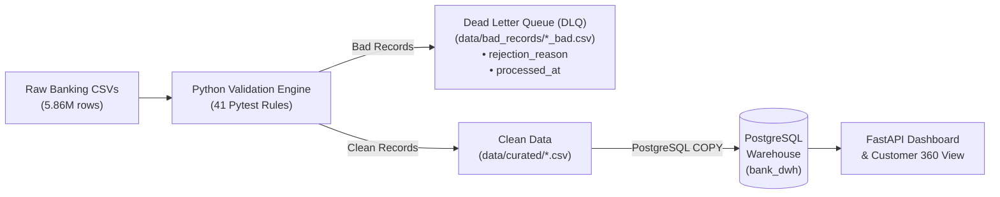

# 🏦 LedgerFlow — Banking Data Pipeline & PostgreSQL Warehouse

> **Target Role**: Junior Data Engineer / Python & SQL Developer  
> **Summary**: A clean, end-to-end Python ETL pipeline that validates banking records, isolates bad rows into a Dead Letter Queue (DLQ), and loads clean data into PostgreSQL with 41 automated Pytest unit tests.

[](tests/test_validation.py)
[](sql/schema/create_tables.sql)
[](https://python.org)
[](cloud_aws/s3_uploader.py)
[](https://ledgerflow17.vercel.app/)

---

## 📌 What Problem Does This Project Solve?

In real banking operations, raw data feeds frequently contain bad data: negative account balances, credit scores outside the 300–850 range, transactions pointing to closed or non-existent accounts, and invalid email formats. If you try to bulk-load this raw data directly into a relational database, the database crashes with foreign key or constraint errors.

**LedgerFlow solves this by:**
1. **Reading 10 Relational Datasets**: Customers, Accounts, Transactions, Loans, Cards, Branches, Employees, etc.
2. **Validating Data in Python**: Checks formats, data types, value ranges, and parent-child relationships before touching the database.
3. **Isolating Bad Rows (Dead Letter Queue)**: Clean records are kept for the warehouse; bad records are routed to `data/bad_records/` with the exact `rejection_reason` so nothing is lost.
4. **Fast PostgreSQL Ingestion**: Loads clean records into PostgreSQL using the native high-speed `COPY` command.
5. **Testing Everything**: 41 automated Pytest unit tests verify every data validation rule.
6. **Viewing the Results**: A clean web dashboard and REST API (FastAPI) showing warehouse KPIs and Customer 360 profiles.

---

## 📊 Project Numbers at a Glance

* **Total Records Ingested**: **5,868,950** rows across 10 datasets
* **Clean Records Loaded**: **5,148,430** rows (87.72% pass rate)
* **Bad Records Quarantined**: **720,520** rows (saved in DLQ with audit reason)
* **Automated Unit Tests**: **41 / 41 passing** (Pytest)
* **Database**: PostgreSQL (10 tables with Primary & Foreign Keys)
* **Live Links**:
  * 🌐 **Executive Dashboard**: [https://ledgerflow17.vercel.app/](https://ledgerflow17.vercel.app/)
  * 📑 **Data Quality Audit Report**: [https://ledgerflow17.vercel.app/audit-report](https://ledgerflow17.vercel.app/audit-report)
  * ⚡ **API Documentation (Swagger)**: [https://ledgerflow17.vercel.app/docs](https://ledgerflow17.vercel.app/docs)

---

## 🔄 Simple Architecture & Data Flow



---

## 💡 How to Explain This Project in an Interview (Simple Script)

### The 30-Second Elevator Pitch:
> *"I built a banking data pipeline in Python that processes around 5.8 million records across 10 relational banking datasets—like customers, accounts, loans, and transactions. The main problem I solved was data quality: instead of letting corrupt records crash the database, my script validates each row, saves invalid rows into a Dead Letter Queue with the rejection reason, and bulk-loads only the clean rows into PostgreSQL using the COPY command. I also wrote 41 Pytest unit tests to verify the validation rules."*

---

### Top 5 Interview Questions & Easy, Bulletproof Answers:

#### Q1: "How did you validate and clean the data?"
> *"I wrote Python validator functions for each dataset using Pandas. For example, for customers, I checked that email addresses match a valid regex, credit scores are between 300 and 850, and income is strictly positive. For transactions, I verified that amounts are greater than zero and that the account ID actually exists in the curated accounts table."*

#### Q2: "What did you do when you found bad or corrupt rows?"
> *"I used a Dead Letter Queue (DLQ) pattern. In banking, you can't just delete bad data or ignore it. When a row fails a rule, I write it to a `bad_records` CSV file and append two extra columns: `rejection_reason` (like 'Credit score out of bounds') and `processed_at`. This keeps the database clean while giving source teams an audit trail to fix the issues."*

#### Q3: "How did you handle foreign key dependencies between tables?"
> *"In a relational database, you cannot insert transactions if the accounts don't exist yet, and you cannot insert accounts if the customers don't exist. I executed the pipelines in a strict order: first master tables (Branches, Customers), then child tables (Accounts, Loans, Cards), and finally transaction tables. This guaranteed that when transactions were validated, all valid account IDs were already in memory for instant lookups."*

#### Q4: "How did you handle memory constraints when processing 5.8M rows?"
> *"The transaction dataset had over 2 million rows and card transactions had 3 million. Loading all of that into RAM at once can cause Out-Of-Memory errors. I used Pandas chunk streaming with `chunksize=250,000` to process the file in batches. For the database load, instead of slow `pandas.to_sql` which does row-by-row inserts, I used PostgreSQL's native `COPY` command via `psycopg2`, which streams CSV data directly into the database in seconds."*

#### Q5: "How did you test your code?"
> *"I wrote 41 automated unit tests using Pytest. The tests cover both valid data and edge cases—such as missing IFSC codes, duplicate IDs, negative balances, and loan payments where the principal plus interest doesn't equal the total amount. All 41 tests run automatically on every git push through GitHub Actions CI."*

---

## 📊 Dataset & Ingestion Breakdown

| Dataset | Raw Ingested | Clean Records | Bad Records (DLQ) | Pass Rate | Primary Rejection Reason Caught |
| :--- | :---: | :---: | :---: | :---: | :--- |
| **`branches`** | 150 | 150 | 0 | **100.0%** | None (Master Lookup) |
| **`employees`** | 1,800 | 1,800 | 0 | **100.0%** | None (Master Lookup) |
| **`customers`** | 60,000 | 55,050 | 4,950 | **91.75%** | Credit score < 300 or > 850; invalid email format |
| **`accounts`** | 95,000 | 87,177 | 7,823 | **91.77%** | Customer ID not found in curated customers; unapproved status |
| **`transactions`** | 2,000,000 | 1,835,551 | 164,449 | **91.78%** | Account ID not found in accounts; non-positive amount |
| **`loans`** | 22,000 | 20,137 | 1,863 | **91.53%** | Interest rate out of bounds; customer ID not found |
| **`loan_payments`** | 600,000 | 549,015 | 50,985 | **91.50%** | Principal + Interest != Total amount paid (> $0.05 tolerance) |
| **`cards`** | 65,000 | 54,643 | 10,357 | **84.07%** | Orphan account ID; expiry date before issue date |
| **`card_transactions`**| 3,000,000 | 2,521,980 | 478,020 | **84.07%** | Card ID not found in cards; negative amount |
| **`support_tickets`** | 25,000 | 22,927 | 2,073 | **91.71%** | Resolved date earlier than opened date; satisfaction score > 5 |
| **TOTAL** | **5,868,950** | **5,148,430** | **720,520** | **87.72%** | **Quarantined with audit metadata** |

---

## 🧪 What Validation Rules Are Tested? (41 Tests)

All 41 tests are defined in [`tests/test_validation.py`](tests/test_validation.py):

* **Customers (4 tests)**: Valid records pass; invalid email formats rejected; credit scores outside 300–850 rejected; negative income rejected.
* **Branches (4 tests)**: Missing IFSC code rejected; blank branch names rejected; duplicate IDs rejected; date parsing verified.
* **Accounts (4 tests)**: Valid account types (Savings, Current, Salary, FD, NRI); negative balance rejected; orphan customer ID rejected.
* **Employees (4 tests)**: Valid roles; negative salary rejected; orphan branch ID rejected.
* **Transactions (4 tests)**: Zero or negative amounts rejected; channels validated (ATM, UPI, Mobile App); orphan account ID rejected.
* **Loans (4 tests)**: Interest rate range (1% to 50%); negative loan term rejected; orphan customer ID rejected.
* **Loan Payments (4 tests)**: Principal + Interest must equal total paid within 5 cents; negative amounts rejected.
* **Cards (4 tests)**: Expiry date must be after issue date; negative limit rejected; dual foreign key (customer + account) checked.
* **Card Transactions (4 tests)**: Empty merchant rejected; fraud flag must be 0 or 1; orphan card ID rejected.
* **Support Tickets (5 tests)**: Resolved date cannot be before opened date; satisfaction score must be 1 to 5.

---

## ⚡ How to Run This Project

### 1. Run Unit Tests (Pytest)
```bash
pytest -v
```

### 2. Run the Full Pipeline (One Command)
```bash
./run_all.sh
```
*This runs all 41 tests, validates all 10 datasets, creates clean curated files and DLQ bad records, and loads PostgreSQL.*

### 3. Start the Web Dashboard & API
```bash
uvicorn scripts.api:app --reload
```
Open **`http://localhost:8000`** in your browser to view the live dashboard, charts, and data explorer.

---

## 🛠️ Tech Stack

* **Language**: Python 3.11+ (Pandas, Pytest)
* **Database**: PostgreSQL (Foreign Keys, Indexes, Native `COPY`)
* **Cloud Storage**: AWS S3 (Backup storage for raw and clean files)
* **API & Web**: FastAPI, Uvicorn, Chart.js
* **DevOps**: GitHub Actions (Automated CI), Docker

---

## 📄 License
This project is open-source under the MIT License. Built for data engineering learning and technical interviews.
