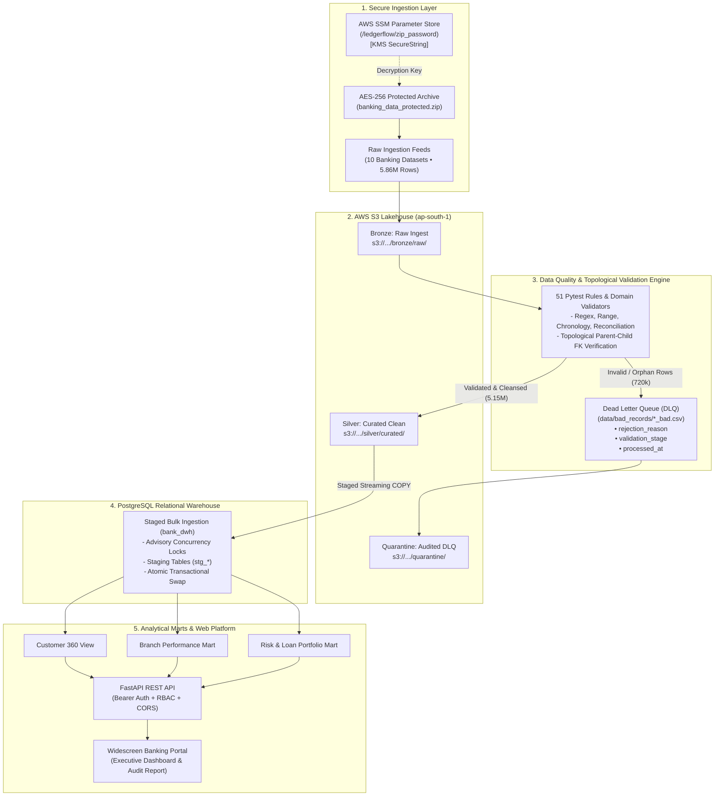

# 🏦 LedgerFlow — Banking Data Engineering Pipeline & Analytical Warehouse

[](https://github.com/Spidey173/LedgerFlow/actions/workflows/ci.yml)
[](tests/)
[](sql/schema/create_tables.sql)
[](https://python.org)
[](cloud_aws/s3_uploader.py)
[](cloud_aws/secure_ingest.py)
[](docker-compose.yml)

> 🏦 **Live Banking Executive Dashboard**: **[https://ledgerflow17.vercel.app/](https://ledgerflow17.vercel.app/)**  
> 📑 **Data Quality & DLQ Audit Report**: **[https://ledgerflow17.vercel.app/audit-report](https://ledgerflow17.vercel.app/audit-report)**  
> ⚡ **Interactive Swagger REST API**: **[https://ledgerflow17.vercel.app/docs](https://ledgerflow17.vercel.app/docs)**  
> ☁️ **AWS S3 Cloud Lakehouse**: `s3://ledgerflow-banking-511492912610/` (Bronze `raw/`, Silver `curated/`, DLQ `quarantine/`)  

---

## 📌 Executive Summary

**LedgerFlow** is a resilient banking data engineering pipeline and relational data warehouse built using **Python, PostgreSQL, AWS S3, and AWS Systems Manager (SSM)**. 

Processing **5.86 million core banking records** across 10 interconnected entities, the project solves the core engineering challenges encountered in modern financial data platforms:
1. **Topological Dependency Ordering**: Enforces strict parent-child validation hierarchy to prevent foreign key constraint violations prior to database bulk loading.
2. **Automated Dead Letter Queue (DLQ)**: Quarantines invalid records (720k+ rows) with audit metadata (`rejection_reason`, `validation_stage`, `processed_at`) rather than silently dropping or crashing.
3. **Enterprise Ingestion Security**: Protects raw data feeds using AES-256 encrypted ZIP archives decrypted on the fly using credentials stored in **AWS SSM Parameter Store** as a KMS `SecureString`.
4. **Memory-Efficient Chunk Streaming**: Streams multi-million row transaction feeds (`chunksize=250k-300k`) and leverages PostgreSQL's native binary `COPY` protocol to bulk-load data with predictable RAM usage.
5. **Non-Destructive Staged Refreshes**: Staged table swaps (`stg_*`) and PostgreSQL advisory locks protect the live warehouse against concurrency corruption and data loss on pipeline failure.
6. **Continuous Quality Assurance**: 51 automated Pytest unit and integration tests run on every commit via **GitHub Actions CI**.

---

## 📊 Project Numbers at a Glance

* **Total Records Ingested**: **5,868,950** rows across 10 datasets
* **Clean Records Loaded**: **5,148,430** rows (87.72% pass rate)
* **Bad Records Quarantined**: **720,520** rows (saved in DLQ with audit reason)
* **Automated Unit & Integration Tests**: **51 / 51 passing** (Pytest)
* **Database**: PostgreSQL (10 tables with Primary & Foreign Keys, B-tree indexes)

---

## 🔄 End-to-End System Architecture



---

## 📊 Dataset & Ingestion Breakdown

| Dataset | Raw Ingested | Clean Records | Bad Records (DLQ) | Pass Rate | Primary Rejection Reason Caught |
| :--- | :---: | :---: | :---: | :---: | :--- |
| **`branches`** | 150 | 150 | 0 | **100.0%** | None (Master Lookup) |
| **`employees`** | 1,800 | 1,800 | 0 | **100.0%** | None (Master Lookup) |
| **`customers`** | 60,000 | 55,050 | 4,950 | **91.75%** | Credit score < 300 or > 850; invalid email format |
| **`accounts`** | 95,000 | 87,177 | 7,823 | **91.77%** | Customer ID not found in curated customers; unapproved status |
| **`transactions`** | 2,000,000 | 1,835,551 | 164,449 | **91.78%** | Account ID not found in accounts; non-positive amount |
| **`loans`** | 22,000 | 20,137 | 1,863 | **91.53%** | Interest rate out of bounds; customer ID not found |
| **`loan_payments`** | 600,000 | 549,015 | 50,985 | **91.50%** | Principal + Interest != Total amount paid (> $0.05 tolerance) |
| **`cards`** | 65,000 | 54,643 | 10,357 | **84.07%** | Orphan account ID; expiry date before issue date |
| **`card_transactions`**| 3,000,000 | 2,521,980 | 478,020 | **84.07%** | Card ID not found in cards; negative amount |
| **`support_tickets`** | 25,000 | 22,927 | 2,073 | **91.71%** | Resolved date earlier than opened date; satisfaction score > 5 |
| **TOTAL** | **5,868,950** | **5,148,430** | **720,520** | **87.72%** | **Quarantined with audit metadata** |

---

## ⚡ Quickstart: One-Command Execution

### Option A: Standard Full Pipeline Run (Local)
```bash
./run_all.sh
```
*Or using Make:*
```bash
make run
```
> **What this executes:**
> 1. Runs **51 Pytest validation, security, and refresh tests**.
> 2. Executes the **10-dataset pipeline in topological dependency order** (~5.86M raw rows -> ~5.15M curated rows + 720k rows routed to DLQ).
> 3. Connects to PostgreSQL, loads curated data via non-destructive staged `COPY`, and refreshes analytical summary tables.
> 4. Generates an execution summary report showing processed counts and runtimes.

---

### Option B: Enterprise Secure Ingestion (AWS SSM + AES-256 ZIP)
```bash
./run_all.sh --secure
```
*Or using Make:*
```bash
make aws-secure
```
> **What this executes:**
> 1. Dynamically connects to **AWS Systems Manager (SSM) Parameter Store** (`/ledgerflow/zip_password`).
> 2. Decrypts the KMS `SecureString` password on the fly.
> 3. Streams and extracts the AES-256 password-protected banking archive in memory.
> 4. Validates data quality, routes bad records to DLQ, and streams clean data directly to PostgreSQL staging.

---

### Option C: AWS Cloud Lakehouse Execution
```bash
./run_all.sh --aws
```
*Or using Make:*
```bash
make aws-pipeline
```
> **What this executes:**
> Ingests raw datasets to **AWS S3 Bronze** (`s3://.../bronze/raw/`), executes cleaning rules into **S3 Silver** (`s3://.../silver/curated/`), routes bad records to **S3 DLQ** (`s3://.../quarantine/`), and loads to PostgreSQL.

---

### Option D: Dockerized Warehouse & API Stack
```bash
docker-compose up --build -d
```
*Spins up PostgreSQL 15 and the FastAPI service with auto-initialized schemas and health checks on `http://localhost:8000`.*

---

## 🔒 Configuration & Security Architecture

### Environment Variables (.env)
Copy `.env.example` to `.env` to configure your environment. Required and optional parameters:

| Variable | Required | Default | Description |
| :--- | :---: | :--- | :--- |
| `DB_HOST` | Yes | `localhost` | PostgreSQL host address |
| `DB_PORT` | Yes | `5432` | PostgreSQL port |
| `DB_NAME` | Yes | `bank_dwh` | Database name |
| `DB_USER` | Yes | `postgres` | Warehouse database user |
| `DB_PASSWORD` | Yes* | *(none)* | Warehouse password (required unless `DATABASE_URL` is set) |
| `DATABASE_URL` | No | *(none)* | Full PostgreSQL connection URI |
| `ALLOWED_ORIGINS` | No | `http://localhost:3000,http://localhost:8000...` | Strict CORS origin allowlist (comma-separated, no `*` in prod) |
| `API_AUTH_ENABLED` | No | `false` | When `true`, enforces Bearer token authentication on all entity endpoints |
| `API_KEYS` | If auth | *(none)* | Comma-separated `token:role` mappings (e.g., `key1:read_only,key2:analyst,key3:admin`) |
| `DEMO_MODE` | No | `false` | When `false`, failed DB queries return HTTP 503; when `true`, explicitly serves labeled sandbox data |
| `ZIP_DECRYPTION_PASSWORD` | If secure | *(none)* | AES-256 decryption key if AWS SSM is not used |
| `AWS_ACCESS_KEY_ID` | If AWS | *(none)* | AWS access key for S3 / SSM |
| `AWS_SECRET_ACCESS_KEY` | If AWS | *(none)* | AWS secret access key |
| `AWS_DEFAULT_REGION` | If AWS | `ap-south-1` | AWS region |
| `S3_BUCKET_NAME` | If AWS | *(none)* | S3 bucket for Bronze/Silver/DLQ layers |

### Security Assumptions
1. **Zero Hardcoded Secrets**: All passwords and keys are supplied via environment variables, container secrets, or AWS SSM Parameter Store. Missing database passwords fail fast at startup.
2. **KMS-Only SSM Parameters**: Secrets pushed to SSM are stored strictly as KMS-backed `SecureString` types. Plaintext fallbacks are rejected.
3. **Role-Based Access Control (RBAC)**:
   - `read_only`: Can access `/customers`, `/customer/{id}`, `/accounts`, `/transactions`, `/loans`, `/cards`.
   - `analyst`: Can additionally access `/dashboard` and `/customer-360`.
   - `admin`: Full platform and administrative privileges.
4. **Log Redaction**: Secret tokens, database URIs, passwords, and AWS credentials are automatically filtered and redacted from all console and file logs (`SensitiveDataFilter`).
5. **Bounded API Requests**: Query endpoints enforce strict pagination (`ge=1, le=200`) and input validation to prevent memory exhaustion and Denial-of-Service.

---

## 🛡️ Safe Database Refreshes & Operational Reliability

### Non-Destructive Staged Refreshes
- **Staging Tables (`stg_*`)**: Clean curated data is loaded via binary `COPY` into unlogged staging tables rather than truncating live warehouse tables directly.
- **Atomic Transactional Swap**: Live tables are swapped within a single transaction (`BEGIN ... INSERT ... COMMIT`). If a file is missing or a batch fails, the entire transaction rolls back cleanly, leaving existing data untouched.
- **Concurrency Protection**: Uses PostgreSQL transactional advisory locks (`pg_try_advisory_lock`) to reject overlapping pipeline runs and prevent data corruption.
- **Failure Transparency**: Database connection and query failures return explicit `HTTP 503 Service Unavailable` responses. Demo fallback data is served **only** when `DEMO_MODE=true` is explicitly configured.

---

## 🧪 Automated Testing Suite (51 Tests)

All 51 tests are executed via `pytest`:
* **Data Quality & Integrity (41 tests - `tests/test_validation.py`)**: Schema integrity, primary key constraints, domain boundary checks, foreign key referential integrity, accounting reconciliation.
* **API Security & RBAC (7 tests - `tests/test_api_security.py`)**: Health/readiness checks, pagination bounds, Bearer token authentication, role-based authorization, CORS restriction, transparent 503 failure handling.
* **Database Staged Refresh (3 tests - `tests/test_safe_refresh.py`)**: Staging table lifecycle, transactional swap ordering, concurrency advisory locks.

---

## ⚠️ Known Limitations & Production Readiness Roadmap

1. **Schema Migrations**: Schema creation currently uses raw DDL scripts (`sql/schema/create_tables.sql`). Production systems should adopt **Alembic** or **Flyway** for tracked, reversible schema versions.
2. **Automated Alerting**: Dead Letter Queue records are audited to CSV/S3, but real-time alerting (PagerDuty, Slack, Amazon SNS) on threshold spikes is not yet wired to a live notification bus.
3. **Incremental CDC Sync**: The current pipeline performs scheduled bulk staged refreshes. Streaming change-data-capture (Debezium / Kafka Connect) would be required for sub-second replication.
4. **Data Freshness SLAs**: Monitoring dashboards and automated SLA health probes should be integrated to enforce freshness guarantees.

---

## 📋 Master CLI Command Reference

| Command | Action |
| :--- | :--- |
| **`./run_all.sh`** | **One-command master run**: executes 51 tests, 10 ETL pipelines, and DB load. |
| **`./run_all.sh --secure`** | **Enterprise Secure Ingestion**: fetches AWS SSM key, decrypts AES-256 ZIP, and loads DB. |
| **`./run_all.sh --aws`** | **AWS Cloud Lakehouse Run**: S3 Bronze ingestion, Glue ETL, DLQ routing, and DB load. |
| **`./run_all.sh --test-only`**| Runs only the 51 Pytest validator & security test suite. |
| **`./run_all.sh --api`** | Runs full pipeline and immediately launches local FastAPI server. |
| **`make test`** | Runs Pytest with verbose test descriptions. |
| **`make aws-secure`** | Runs the AWS SSM Parameter Store + AES-256 ZIP ingestion script. |
| **`make etl`** | Runs the 10-dataset master ETL pipeline. |
| **`make load`** | Loads curated CSVs into PostgreSQL via staged transactional COPY. |
| **`docker-compose up --build -d`** | Starts containerized PostgreSQL warehouse and FastAPI. |

---

## 📄 License
This project is licensed under the MIT License. Built for data engineering demonstrations and technical interviews.
